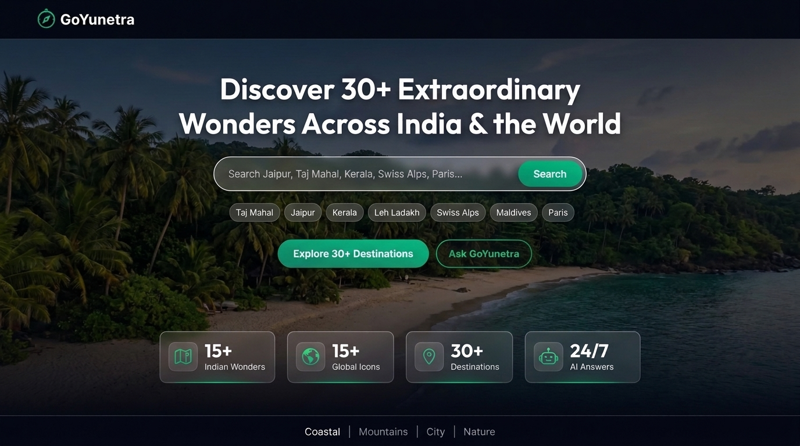
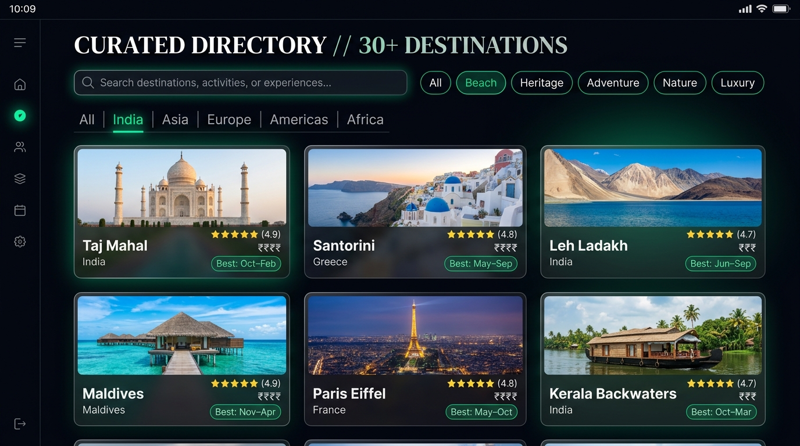
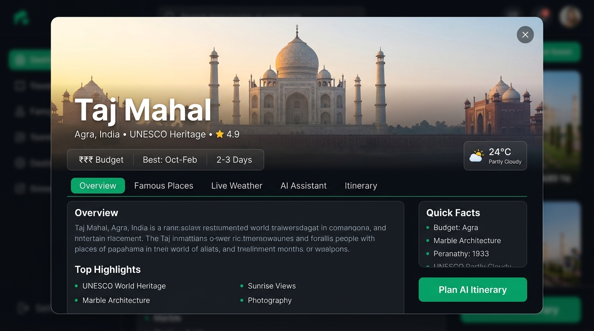
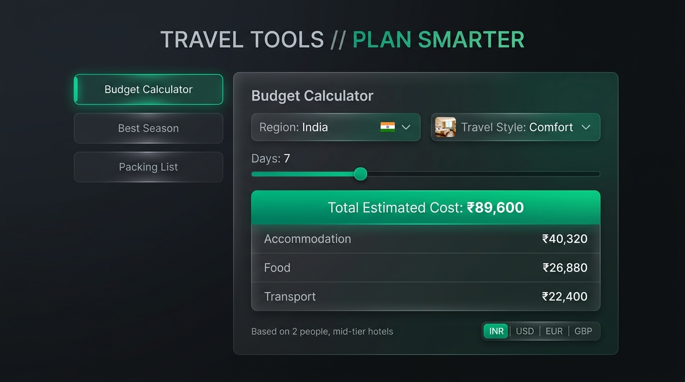
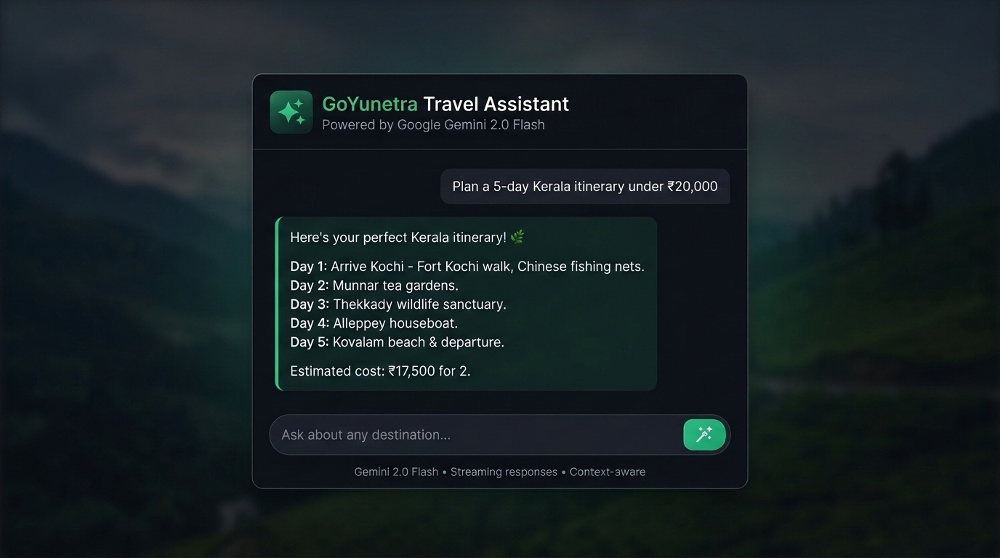

<div align="center">

# 🌍 GoYunetra — India & Beyond

### AI-Powered Travel Companion for 30+ Extraordinary Destinations

[](https://travel-app-peach-iota.vercel.app)
[](https://react.dev)
[](https://vitejs.dev)
[](https://ai.google.dev)
[](https://travel-app-peach-iota.vercel.app)

</div>

---

## ✈️ Live Demo

> ### 🌐 [https://travel-app-peach-iota.vercel.app](https://travel-app-peach-iota.vercel.app)
> Open the link above — no installation needed. The full app is live on Vercel.

---

## 📖 What is GoYunetra?

**GoYunetra** is an AI-powered, single-page travel discovery platform that helps you explore **30+ extraordinary destinations** across India and the world — all in one beautifully designed interface.

Instead of jumping between dozens of travel websites, GoYunetra gives you everything in one place:
- 🗺️ A curated database of **15+ Indian wonders** + **15+ global icons**
- 🌤️ **Live weather** at every destination via Open-Meteo API
- 🤖 **Gemini AI chatbot** for instant travel advice and itinerary planning
- 💰 **Budget calculator** with real-time currency conversion
- 📅 **Day-by-day AI itinerary generator** with one-click PDF export
- 🎬 **Cinematic ambient video backgrounds** (Coastal · Mountains · City · Nature)

---

## 📸 Screenshots

### 🏠 Hero — Cinematic Landing Page
> Search across 30+ destinations with smart quick-tags, ambient video backgrounds, and live travel stats.



---

### 🔍 Destination Explorer
> Browse 30+ destinations with real-time search, category filters (Beach · Heritage · Adventure · Nature · Luxury), and continent tabs.



---

### 🗺️ Destination Detail Modal
> Click any card to open a rich detail modal with 5 tabs: Overview · Famous Places · Live Weather · AI Assistant · Itinerary Planner.



---

### 💰 Travel Tools — Budget Calculator
> Estimate trip costs by region and travel style, with live currency conversion (INR · USD · EUR · GBP · JPY).



---

### 🤖 GoYunetra Chatbot
> Powered by Google Gemini 2.0 Flash — ask anything from "best food in Jaipur" to "7-day Kerala itinerary under ₹20,000".



---

## ✨ Features at a Glance

| Feature | Description |
|---|---|
| 🏔️ **30+ Curated Destinations** | Handpicked Indian & global wonders with descriptions, photos, highlights & insider tips |
| 🔍 **Smart Explorer** | Filter by continent, category, price level, and season — with real-time search |
| 🌤️ **Live Weather** | Real-time conditions fetched from the free Open-Meteo API for each destination |
| 🤖 **GoYunetra Chatbot** | Google Gemini 2.0 Flash powers instant, context-aware travel Q&A |
| 📅 **Itinerary Planner** | AI-generated day-by-day plan (1–14 days) with **PDF export** |
| 💰 **Budget Calculator** | Trip cost estimator across Budget / Comfort / Luxury tiers for 5 regions |
| 💱 **Currency Converter** | Real-time rates for INR · USD · EUR · GBP · JPY |
| 📍 **Geolocation Banner** | Detects your location and shows distance to each destination |
| 🌓 **Dark / Light Mode** | Fully themed with an eye-friendly Emerald & Sage colour system |
| 📱 **Responsive Design** | Mobile-first layout that works across all screen sizes |
| 🎬 **Ambient Video Channels** | Switch between Coastal, Mountains, City, and Nature backgrounds |

---

## 🛠️ Tech Stack

| Layer | Technology | Purpose |
|---|---|---|
| **Framework** | React 19 | Component-based UI with hooks |
| **Build Tool** | Vite 8 | Lightning-fast HMR dev server & bundler |
| **AI Engine** | Google Gemini 2.0 Flash (`@google/genai`) | AI chatbot & itinerary generation |
| **Weather API** | Open-Meteo (free, no key required) | Live weather for each destination |
| **Styling** | Vanilla CSS + CSS Variables | Custom design system, dark/light modes |
| **Icons** | Lucide React | Consistent icon library |
| **PDF Export** | jsPDF + html2canvas | Itinerary download |
| **Geolocation** | Browser Navigator API | User location detection |
| **Deployment** | Vercel | Edge CDN, CI/CD |

---

## 🚀 Run Locally

### Prerequisites
- **Node.js** 18+
- A **Gemini API key** — get one free at [aistudio.google.com](https://aistudio.google.com/app/apikey)

### Steps

```bash
# 1. Clone the repository
git clone https://github.com/LakshmiCharith/GoYunetra.git
cd GoYunetra

# 2. Install dependencies
npm install

# 3. Set up environment variables
cp .env.example .env
```

Edit `.env` and add your key:
```env
VITE_GEMINI_API_KEY=your_gemini_api_key_here
```

```bash
# 4. Start the dev server
npm run dev
```

Open **[http://localhost:5173](http://localhost:5173)** in your browser.

### Build for Production
```bash
npm run build && npm run preview
```

---

## 📁 Project Structure

```
GoYunetra/
├── index.html                       # App entry, Google Fonts, meta tags
├── vite.config.js                   # Vite config
├── package.json                     # Dependencies & scripts
├── .env.example                     # Environment variable template
├── screenshots/                     # README screenshots
│
└── src/
    ├── App.jsx                      # Root component, theme toggle, AI drawer
    │
    ├── components/
    │   ├── Hero.jsx                 # Cinematic landing with video & search
    │   ├── Navbar.jsx               # Navigation, theme toggle, AI button
    │   ├── DestinationExplorer.jsx  # Search, filter, sort, destination grid
    │   ├── DestinationCard.jsx      # Individual destination card
    │   ├── DestinationDetailModal.jsx  # Full detail popup (5 tabs)
    │   ├── WeatherCard.jsx          # Live weather widget
    │   ├── AIChatbot.jsx            # Gemini AI chat interface
    │   ├── ItineraryPlanner.jsx     # Day-by-day planner + PDF export
    │   ├── TravelToolsSection.jsx   # Budget calculator, currency, timing
    │   ├── LocationBanner.jsx       # Geolocation distance display
    │   ├── SettingsModal.jsx        # API key & preferences
    │   └── Footer.jsx               # Site footer
    │
    ├── services/
    │   ├── geminiService.js         # Google Gemini API integration
    │   ├── weatherService.js        # Open-Meteo API fetcher
    │   ├── imageService.js          # Destination photo fetcher
    │   └── locationService.js       # Geolocation & distance calculations
    │
    ├── data/
    │   └── destinations.js          # 30+ destinations database
    │
    └── styles/
        ├── variables.css            # Design tokens (colours, spacing, shadows)
        └── global.css               # Utility classes & animations
```

---

## 🔗 Links

| Resource | URL |
|---|---|
| **🚀 Live Application** | **[https://travel-app-peach-iota.vercel.app](https://travel-app-peach-iota.vercel.app)** |
| **💻 GitHub Repository** | [github.com/LakshmiCharith/GoYunetra](https://github.com/LakshmiCharith/GoYunetra) |

---

## 👤 Author

**LakshmiCharith** — [github.com/LakshmiCharith](https://github.com/LakshmiCharith)

---

## 📄 License

This project is open-source for educational and portfolio purposes.
